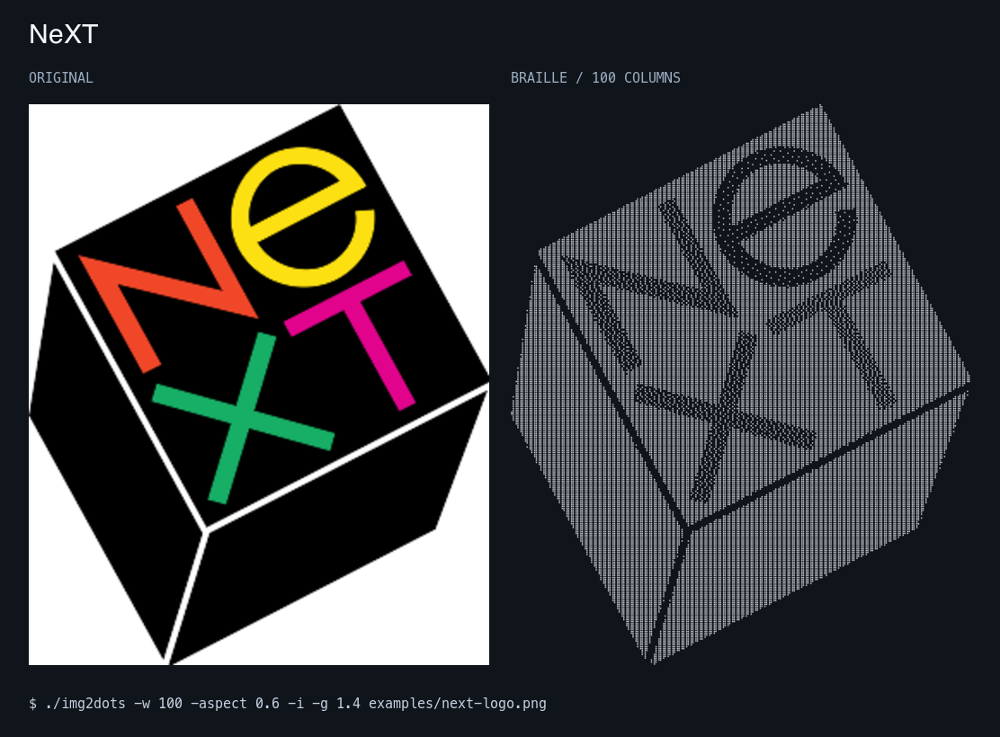

# img2dots

Convert WebP, JPEG, and PNG images to **Unicode Braille art** in your terminal.
Each character carries a 2×4 grid of dots. Works offline with local files or
piped image data and writes UTF-8 plain text, with no terminal escape codes.



NeXT logo by Paul Rand, via [Wikimedia Commons](https://commons.wikimedia.org/wiki/File:NeXT_logo.svg).
The SVG was rasterized to the included [PNG input](examples/next-logo.png) before
conversion. [View the Braille text](examples/next-logo.txt).

## Build and try it

Requires Go 1.24.2 or later. Install the current Braille renderer from source:

```sh
go install github.com/corywilkerson/img2dots@main
img2dots -w 120 -auto-contrast photo.webp
```

Or build a local checkout:

```sh
git clone https://github.com/corywilkerson/img2dots.git
cd img2dots
go build -o img2dots .
./img2dots photo.webp
```

On Windows, build with `go build -o img2dots.exe .`.

## Examples

```sh
# More detail and a wider tonal range
./img2dots -w 160 -auto-contrast photo.jpg

# Bring out shadows in a dark photograph
./img2dots -w 120 -auto-contrast -g 1.4 photo.jpg

# Clean silhouettes without dithering
./img2dots -dither none logo.png

# Reverse light and dark dots
./img2dots -i photo.png

# Composite transparent pixels against black
./img2dots -background black logo.png

# Read image data from a pipe
cat photo.webp | ./img2dots -w 100 -

# Save the artwork; status messages go to stderr
./img2dots -o art.txt photo.png
./img2dots photo.png > art.txt
```

Put options **before** the image path. Use `--` before filenames that start with
a dash. `-` reads image bytes from stdin; `-o -` explicitly selects stdout.

## Options

| Option | Default | Purpose |
| --- | --- | --- |
| `-w`, `-width` | `80` | Output width, 10–1000 characters |
| `-i`, `-invert` | `false` | Invert light and dark dots |
| `-o`, `-output` | stdout | Save artwork to a file |
| `-c`, `-contrast` | `1` | Contrast, 0.5–3 |
| `-g`, `-gamma` | `1` | Gamma, 0.5–2; values above 1 lighten midtones |
| `-b`, `-brightness` | `0` | Brightness, −0.5–0.5 |
| `-aspect` | `0.45` | Character width/height ratio, 0.1–1 |
| `-background` | `white` | Background for transparency: `white` or `black` |
| `-auto-contrast` | `false` | Stretch the tonal range, clipping the darkest/lightest 1% |
| `-sharpen` | `0.35` | Local edge sharpening, 0–2; use 0 to disable |
| `-dither` | `floyd-steinberg` | `floyd-steinberg` for shading or `none` for silhouettes |
| `-version` | | Print the embedded release version (`dev` for local builds) |
| `-h`, `-help` | | Show usage |

## Getting the best result

At 120 columns, the renderer samples 240 horizontal positions and four vertical
positions per output row. Increase `-w` when you have room for more columns.
Use `-auto-contrast` for photos with a narrow tonal range and `-g 1.4` to lift
shadow detail. Light pixels produce filled dots; `-i` reverses that polarity.
The transparency background is independent of inversion.

Output needs a font with Braille glyphs (U+2800–U+28FF). Adjust `-aspect` if
your font's character proportions stretch the image. Blank cells use the
Unicode Braille blank, preserving column widths.

The pipeline uses Catmull–Rom cubic resampling, premultiplied alpha compositing,
optional percentile contrast stretching, gamma/brightness/contrast controls,
and a gentle unsharp mask. Serpentine Floyd–Steinberg dithering preserves local
shading by spreading quantization error into neighboring dots. It can look
grainy at large font sizes; use `-dither none` for silhouettes. Reduce sharpening
if it exaggerates noise.

Very wide images still produce at least one row. The render grid is limited to
two million samples, counting eight samples per character; reduce width or
aspect ratio if you hit the limit. Inputs are limited to 64 MiB of encoded data
and 64 megapixels, checked before pixel decoding. Output is grayscale
still-image art.

File output is written to a temporary file beside the destination and replaces
it only after a successful write. Existing file permissions are preserved;
symlink destinations are rejected.

[Sample Braille output](examples/landscape-braille.txt): 100 columns and 30 rows,
with automatic contrast and gamma 1.4 to lift shadow detail.

## Development and releases

```sh
go test -race -cover ./...
go vet ./...
bash scripts/test-install.sh

# Build five platform archives plus SHA256SUMS locally
VERSION=v1.1.0 ./build.sh
```

Ready-to-use GitHub Actions templates are in
[`contrib/github-actions`](contrib/github-actions). To enable them, copy
`ci.yml` and `release.yml` into `.github/workflows/`. Updating that directory
requires a GitHub credential with workflow permissions.

The CI template checks tests, formatting, vet, and builds on Linux, macOS, and
Windows with both the minimum supported Go version and current stable Go.
Installer tests use local fixtures and never contact GitHub. The release
template tests and builds five platform archives plus checksums when a `v*`
tag is pushed. Archive names and `-version` use the tag.

The existing GitHub v1.0.1 binary release predates the Braille renderer. Use
`go install ...@main` or build this checkout for the current version. The included `install.sh`
fetches published releases into `~/.local/bin` without sudo, accepts `VERSION`
and `INSTALL_DIR`, and verifies new archives against `SHA256SUMS`.
